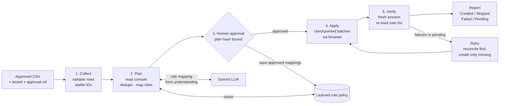

# Bulk User Provisioning Agent

An AI agent that bulk-creates users and assigns roles in SaaS admin consoles **that have no API**. It works through the console's web pages the way a careful IT admin would: it plans first, waits for human approval, acts in checkpointed batches, and then independently verifies the result.

> Built for the **Agentic AI Hackathon 2026 (Ziro.Digital)** · Industry: Developer & Enterprise AI · Problem: *SaaS Admin Bulk User Provisioner*

---

## 1. Problem statement

> *Bulk-create users and roles in admin consoles without an API.*

Many SaaS admin consoles only let you add users one at a time through a web form. When HR sends a list of new hires, an IT admin has to type each one in by hand. That is:

- **Slow:** 20 users means 20 form submissions.
- **Error-prone:** duplicate rows, typos and users that already exist.
- **Risky:** some consoles pre-select a powerful default role, so one missed dropdown can make a new hire an **Admin**.
- **Fragile:** if the console fails halfway, nobody knows exactly who was created, and re-running risks duplicates.

**Official workflow required by the brief**

| Step | Requirement |
|---|---|
| Collect the details | Approved CSV, tenant and roles |
| Plan the next steps | Deduplicate and checkpoint batches |
| Find the information | Admin console |
| Take action (**human approval required**) | Create users |
| Output | Created, skipped and failed users |
| Check it works | Re-read the user list |

---

## 2. Solution overview

The agent applies the **plan → approve → apply → verify** pattern (familiar from infrastructure tools like Terraform) to a UI-only system.

- **The LLM is used only for judgement.** Gemini reads the Add-user form to work out which field is which, and maps HR job titles (e.g. "Finance Analyst") to the console's roles (e.g. "Billing"), with a confidence score and reason for each.
- **Code handles everything safety-critical:** deduplication, "already exists" checks, privilege guards, checkpoints, idempotent retries and verification.
- **A human approves the exact plan** before anything is created. Admin grants need their own separate approval.
- **The agent learns from approvals.** Approved title → role mappings are saved as tenant policy, so the same title always maps to the same role in future runs.
- **Every result is traceable** to its CSV line, the console state observed (URL and timestamp), and screenshots taken before and after each save.

---

## 3. How it works



### Stage 1 · Collect
- Parses the CSV (`name`, `email`, `role`, optional `department`), accepting common header variants.
- Gives every row a **stable ID**: `L<line>-<hash of normalised email>`.
- Flags invalid rows (missing name or role, malformed email) and **duplicate emails**. Emails are matched ignoring case and surrounding spaces.
- Requires a tenant and an **approval reference** (who approved the list, e.g. a ticket ID).

### Stage 2 · Plan
- A Playwright browser logs into the console and **confirms the tenant context** before reading anything.
- Reads **every page** of the existing user list.
- Inspects the Add-user form. **Gemini identifies the name, email and role fields from their labels**, so selectors are not hardcoded.
- Maps job titles to the console's roles, in this order of precedence:
  1. Reviewer override for this run
  2. **Saved role policy** (mappings approved in earlier runs)
  3. **Gemini**, with confidence score and reason
  4. Deterministic keyword rules (fallback)
- **Guards:** an Admin or Owner mapping is blocked unless the CSV explicitly asks for admin rights, and mappings below the confidence threshold go to human review.
- Splits users to create into **batches of 5** and computes a **plan hash**.

### Stage 3 · Approve (human in the loop)
- The dashboard shows every per-user decision with its reason. The reviewer can change any role mapping, which rebuilds the plan and clears any previous approval.
- Approval is bound to the plan hash, so a changed plan can't run on an old approval.
- Privileged (Admin) grants need a **separate checkbox**. Without it, those users are skipped.
- Approved mappings are saved to the tenant's **role policy**.

### Stage 4 · Apply
- Re-reads the console and **reconciles** it with the ledger before touching anything.
- For each user: marks the record **in-flight** in SQLite, opens the form, fills the name and email, **sets the role last**, re-reads the dropdown, saves, and records the outcome and screenshots.
- If the console pre-selected a different role (e.g. Admin), it is **corrected before save** and logged.
- **Stops at the first failure.** Progress is checkpointed after every user and every batch.

### Stage 5 · Verify
- A **separate browser session** re-reads the full user list.
- Each intended user must exist **exactly once** with the **intended role**. Mismatches are reported as failures, not hidden.
- Produces the final Created / Skipped / Failed / Pending report.

### Retry
- Reuses the already-approved plan.
- Re-reads the console first. A user whose save went through despite an error is marked created and **not re-submitted**. Only users that are genuinely missing are created.

---

## 4. Official test cases and results

All four pass, both from the dashboard and from the CLI runner. Evidence files are in [`data/evidence/`](data/evidence/).

| Test | Scenario | Expected | Result |
|---|---|---|---|
| **TC1** | Approved CSV of 20 users | Users created with mapped roles | ✅ **PASS**: 20 created and verified; every observed role equals the approved mapping |
| **TC2** | Same email twice in CSV | One user created | ✅ **PASS**: duplicate (different case and spacing) skipped with reason; console shows exactly 1 account |
| **TC3** | Console defaults new users to Admin | Corrected before save | ✅ **PASS**: Admin pre-selected on every form; agent corrected it before each save; no user ended up Admin |
| **TC4** | Batch fails at user 12 | Retry creates only the missing users | ✅ **PASS**: attempt 1 stopped with 11 created, 1 failed, 8 pending; retry created exactly 9; 20 verified, 0 duplicates |

**Additional behaviour verified**

- The console returns an error but actually saved the user: detected on re-read, no duplicate created.
- Gemini suggests Admin for "Engineering Manager": blocked by the privilege guard and sent to review.
- A user already in the console is skipped. An invalid email is rejected at intake. A legitimate "IT Admin" request is skipped unless the admin-grant box is ticked.
- Gemini model retired, hanging or overloaded: the client fails over to the next available model, then to deterministic rules.

---

## 5. What makes it different

| | Typical automation script | This agent |
|---|---|---|
| Before acting | Starts clicking | Reads the console, builds a reviewable plan |
| Role selection | Hardcoded | LLM with confidence and reason, plus guards, plus learned policy |
| Human control | None | Approval bound to the plan hash; separate admin-grant approval |
| Console quirks | Trusts defaults | Reads the form state, sets the role last, re-checks before save |
| Partial failure | Unknown state, risky re-run | Per-user checkpoints; retry reconciles and creates only missing users |
| Proof | "Script finished" | Independent re-read, per-user evidence and screenshots |
| LLM outage | Fails | Model failover, then deterministic rules |

### Built for reviewers

| Feature | What it does |
|---|---|
| **Shared-console guard** | Only one run can use the demo console at a time. A test case plan waiting for approval holds the console for up to 15 minutes, so two reviewers can't reset each other's runs. At approval, the test case's console settings are re-applied. |
| **Input CSV** | Every run links to the exact CSV it was given (`/api/runs/<id>/input.csv`) |
| **Download evidence** | One JSON per run (`/api/runs/<id>/evidence.json`): input, console state observed, plan and role reasoning, approval, every action with screenshots, verification and the full event log |
| **Health check** | `/healthz` for an uptime pinger, so the free server stays awake during judging |

---

## 6. Tech stack

All free and open source.

| Layer | Technology |
|---|---|
| Language | Python 3.11+ |
| Browser automation | Playwright (Chromium, headless) |
| LLM | Google Gemini API (`gemini-3.8-flash` by default), with automatic model discovery and failover. Any OpenAI-compatible endpoint (e.g. Ollama on a local GPU, Groq) is also supported. |
| Backend / API | FastAPI + Uvicorn |
| State / checkpoints | SQLite (runs, per-record items, event log, learned role policy) |
| Frontend | HTML, CSS and vanilla JavaScript (no build step) |
| Demo target | Mock SaaS admin console (FastAPI, HTML only, no user API) |
| Deployment | Docker on Render (free web service) |

---

## 7. Project structure

```
.
├── agent/
│   ├── csv_input.py        # Stage 1: parse, validate, stable IDs, duplicate detection
│   ├── reasoning.py        # LLM form understanding + role mapping, guards, fallback rules
│   ├── llm.py              # Gemini / OpenAI-compatible client with model failover
│   ├── console_driver.py   # Playwright tool: login, tenant check, read users, create user
│   ├── ledger.py           # SQLite: runs, item checkpoints, events, role policy
│   └── pipeline.py         # collect → plan → approve → apply → verify, retry, report
├── dashboard/
│   ├── server.py           # FastAPI API for the dashboard
│   └── static/             # index.html, app.js, style.css
├── mock_console/
│   └── app.py              # Mock admin console (demo target) + test-harness switches
├── scenarios/
│   ├── definitions.py      # TC1–TC4: setup, expected result, evaluator
│   ├── tc1_approved_20_users.csv
│   ├── tc2_duplicate_email.csv
│   ├── tc3_console_defaults_admin.csv
│   ├── tc4_batch_fails_at_12.csv
│   └── test.csv            # mixed sample: existing user, invalid email, admin request
├── data/evidence/          # test case evidence (JSON per run + summary.md)
├── config.py               # settings from environment / .env
├── run.py                  # local: start console (8001) + dashboard (8000)
├── deploy_app.py           # hosted: dashboard + console on one port
├── run_scenarios.py        # CLI runner for TC1–TC4, writes evidence
├── check_llm.py            # LLM diagnostic: available models, timing, test call
├── Dockerfile
└── requirements.txt
```

---

## 8. The mock admin console

The brief specifies a **mock admin console** as the demo target. It deliberately behaves like a real console with no API:

- HTML pages only: login, tenant picker, a paginated user list (10 per page), and an Add-user form with non-obvious field names.
- Two tenants (`acme`, `globex`) with pre-loaded users.
- **Test-harness switches** at `/__control`, used only to set up scenarios (the agent never calls them):
  - `default_role_admin`: the form pre-selects Admin and resets the role to Admin whenever the email changes (TC3)
  - `fail_at`: the Nth create request fails once (TC4); `fail_mode` can be `before_save` or `after_save`

Demo login: `it.admin` / `demo-pass-123`

---

## 9. Run locally

```bash
pip install -r requirements.txt
playwright install chromium
cp .env.example .env          # Windows: copy .env.example .env  — then add GEMINI_API_KEY
python run.py
```

- Dashboard: http://127.0.0.1:8000
- Admin console: http://127.0.0.1:8001 (test harness: `/__control`)

Run the official test cases from the terminal and write evidence:

```bash
python run_scenarios.py --yes          # all four, scripted approval (recorded as such)
python run_scenarios.py TC3            # one scenario, approve interactively
python run_scenarios.py --fresh --yes  # forget the learned role policy first
python check_llm.py                    # check which Gemini model works for your key
```

Run the single-port hosted version locally (same as production):

```bash
uvicorn deploy_app:app --port 7860
```

---

## 10. Configuration

| Variable | Default | Purpose |
|---|---|---|
| `GEMINI_API_KEY` | (none) | Free key from Google AI Studio |
| `GEMINI_MODEL` | `gemini-3.8-flash` | Preferred model; the agent fails over if it is unavailable |
| `LLM_PROVIDER` | `gemini` | `gemini`, `openai` (any OpenAI-compatible server), or `none` |
| `OPENAI_BASE_URL` / `OPENAI_MODEL` | Ollama defaults | For a local model, e.g. `qwen2.5:3b` |
| `LLM_TIMEOUT` | `20` | Seconds before trying the next model |
| `BATCH_SIZE` | `5` | Users per checkpointed batch |
| `ROLE_CONFIDENCE_THRESHOLD` | `0.6` | Below this, a role mapping needs human review |
| `HEADLESS` / `SLOW_MO_MS` | `1` / `0` | Set `HEADLESS=0`, `SLOW_MO_MS=300` to watch the browser |

---

## 11. Deployment

The `Dockerfile` installs the dependencies and Chromium and serves `deploy_app:app` on `$PORT`.

**Render (free):** New → Web Service → connect this repo → Runtime **Docker** → Instance **Free** → add `GEMINI_API_KEY` and `GEMINI_MODEL` → Deploy.

Free instances sleep when idle, so the first request after a while can take about a minute.

---

## 12. Safety and responsible use

- Human approval is required before any user is created, and admin grants need a separate approval.
- Least privilege: the LLM can never grant Admin unless the input explicitly requests it.
- Only synthetic data is used (`*.example` domains). No real accounts or personal data.
- No OTP or CAPTCHA bypass. The mock console uses plain login.
- The API key is read from environment variables and never committed (`.env` is git-ignored).

## 13. Limitations and next steps

- Demonstrated against the mock console. A real console would need its own login flow (SSO or MFA handled as a manual step) and a quick form check, though form understanding is already label-based.
- One browser job runs at a time. Parallel batches would need per-tenant locking.
- Next steps: deprovisioning and role changes, scheduled syncs from an HR system, and per-tenant policy export.
